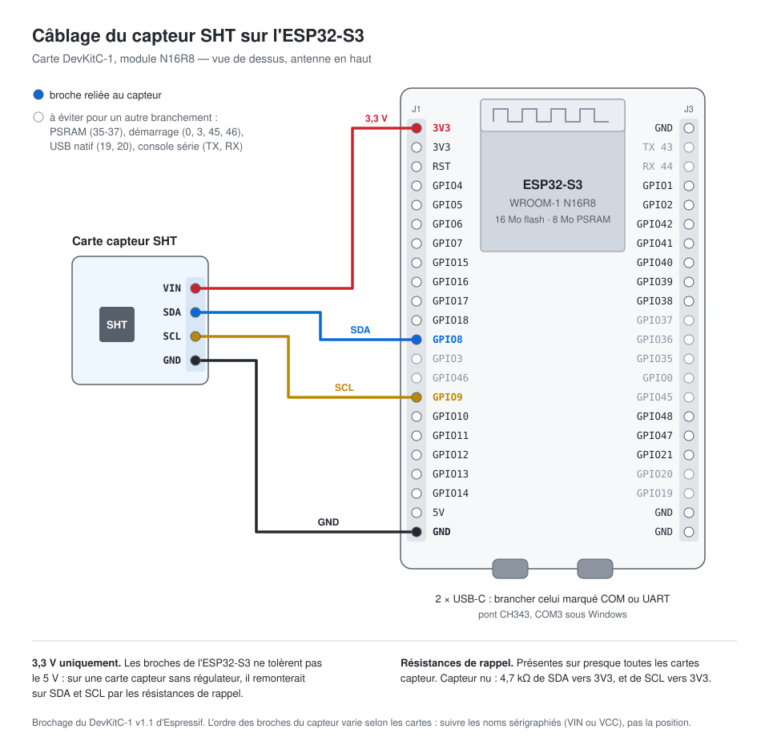

# Firmware

ESP32-S3 et capteur Sensirion SHT : lit la température et l'humidité de la box
toutes les cinq secondes et les affiche sur le port série, avec l'état du
Wi-Fi et du serveur.

Le modèle du capteur est détecté au démarrage (bibliothèque `arduino-sht` :
SHT3x, SHT4x, SHTC3, SHT85…). Un capteur branché ou rebranché après le
démarrage est pris en compte sans redémarrer la carte.

## Câblage

| Capteur | ESP32-S3 |
|---|---|
| VIN | 3V3 |
| GND | GND |
| SDA | GPIO 8 |
| SCL | GPIO 9 |

Les cartes d'évaluation du SHT ont presque toujours leurs résistances de
rappel I2C. Un capteur nu en demande deux, de 4,7 kΩ vers 3V3, sur SDA et SCL.

## Compilation et flash

Avec [PlatformIO](https://platformio.org), depuis ce dossier :

    cp include/secrets.example.h include/secrets.h   # puis le remplir
    pio run -t upload
    pio device monitor

Sortie attendue, le modèle détecté puis une mesure toutes les cinq secondes :

    capteur detecte : SHT4x
    23.4 °C bon  58.1 %HR  wifi 192.168.1.42 -61 dBm  serveur ok

Sans capteur branché, la ligne commence par `capteur introuvable` ; le Wi-Fi
et le serveur sont vérifiés quand même.

`secrets.h` est ignoré par git ; sans lui, la compilation s'arrête sur un
message qui le dit.

## LED

La LED RGB de la carte (WS2812, GPIO 48) montre la température de la box :

| Couleur | Température | Constante |
|---|---|---|
| Bleu | sous 22 °C | `TEMP_COLD_C` |
| Vert | de 22 à 28 °C | |
| Rouge | au-dessus de 28 °C | `TEMP_HOT_C` |
| Éteinte | pas de mesure | |

Les bornes sont la plage de croissance du guide de culture, lampe allumée.
Elles valent jour et nuit : la carte ne dépend ni du serveur ni de l'état de
la lampe, et la nuit la LED passe au bleu dès que la box descend sous 22 °C.
Un demi-degré d'hystérésis évite le clignotement autour d'une borne.

Au démarrage, la LED passe par le bleu, le vert et le rouge, puis s'éteint
jusqu'à la première mesure. L'intensité est volontairement basse
(`LED_LEVEL`) : elle éclaire la box toute la nuit. Sur une DevKitC-1 v1.1,
la LED est sur GPIO 38 et non 48.

## Serveur

La carte envoie un battement à la production, à la même adresse que le
tableau de bord, une fois par minute et dès que le Wi-Fi revient :

    POST /api/box/heartbeat   {"ip": "192.168.1.131", "rssi_dbm": -46, "uptime_s": 3600}

Le tableau de bord la montre en ligne tant que le dernier battement date de
moins de trois minutes (`BOX_TIMEOUT` côté serveur). L'adresse vient de la
carte elle-même : le serveur ne voit que celle du retour de boucle NAT.

| Affichage | Signification |
|---|---|
| `serveur ok` | Le backend a enregistré le battement |
| `serveur HTTP 403` | Apache n'a pas reconnu la carte comme étant du réseau local |
| `serveur HTTP 404` | Le backend déployé ne connaît pas encore la route |
| `serveur HTTP 502` / `503` | Apache répond, mais pas les conteneurs derrière lui |
| `serveur injoignable (…)` | Pas de connexion, ou certificat refusé |

Le certificat est vérifié contre les racines de Let's Encrypt (ISRG Root X1 et
X2), inscrites dans `main.cpp`. Si Let's Encrypt cesse d'envoyer les
signatures croisées vers ces racines, la carte refusera le certificat : il
faudra y ajouter la nouvelle racine.

### Carte

Clone de DevKitC-1 avec un module **N16R8** : ESP32-S3 révision v0.2, 16 Mo
de flash, 8 Mo de PSRAM (relevé avec `esptool flash-id`). `platformio.ini`
part de `esp32-s3-devkitc-1` et corrige la taille de flash.

Le port série passe par un pont **CH343** (port marqué UART, `COM3` sous
Windows). Une carte qui n'aurait que l'USB natif de l'ESP32-S3 n'afficherait
rien tant qu'on n'ajoute pas, dans `platformio.ini` :

    build_flags = -DARDUINO_USB_CDC_ON_BOOT=1

### Depuis WSL2

WSL ne voit pas les ports USB de Windows. Il faut y attacher la carte avec
[usbipd-win](https://github.com/dorssel/usbipd-win), depuis un PowerShell
administrateur :

    usbipd list
    usbipd bind --busid <id>
    usbipd attach --wsl --busid <id>

La carte apparaît alors en `/dev/ttyUSB0` ou `/dev/ttyACM0`.

Sans usbipd ni droits administrateur : compiler dans WSL (`pio run`), puis
flasher depuis Windows avec esptool (`pip install "esptool<5" pyserial` dans
un venv Windows), en lisant les images à travers `\\wsl.localhost`. Depuis un
PowerShell :

    $b = '\\wsl.localhost\Ubuntu\home\<utilisateur>\pepperbox\firmware\.pio\build\esp32s3'
    $app0 = '\\wsl.localhost\Ubuntu\home\<utilisateur>\.platformio\packages\framework-arduinoespressif32\tools\partitions\boot_app0.bin'
    python -m esptool --chip esp32s3 --port COM3 --baud 460800 write_flash `
      --flash_mode keep --flash_freq keep --flash_size keep `
      0x0 "$b\bootloader.bin" 0x8000 "$b\partitions.bin" 0xe000 $app0 0x10000 "$b\firmware.bin"
    python -m serial.tools.miniterm COM3 115200

Ce sont les adresses qu'utilise `pio run -t upload`.

## Déploiement

Le firmware ne passe pas par le CI : un commit qui ne touche que ce dossier ne
reconstruit ni ne redéploie rien (`paths-ignore` dans
`.github/workflows/deploy.yml`).
